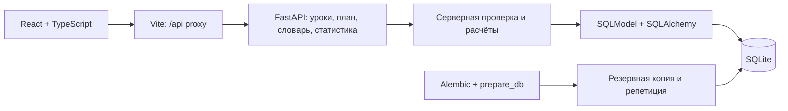

# Academy AI — отчёт о разработке

**Дата:** 04.11.2026, Asia/Almaty. **Ветка:** `feature/academy-ai-v2`.

Проект модернизирован в существующей папке. Новый репозиторий не создавался. Выполнены основные этапы автономной сессии: планировщик, игровые показатели, две учебные библиотеки, аналитика, основа PWA, напоминания, дополнительные повторения слов и проверки. Push и публикации не было.

## 1. Сохранность проекта и данных

- До новых изменений рабочая версия первого модуля сохранена коммитом `af2a6e7`.
- Создана и проверена резервная копия начала сессии: `backups/academy-session-20261103T204613Z.db`.
- Перед изменениями схемы создавались новые копии. Последняя: `backups/academy-before-migration-20261103T211804909986Z.db`; рядом сохранена копия, на которой прошла репетиция миграции.
- `PRAGMA integrity_check` рабочей базы: `ok`. `PRAGMA foreign_key_check`: нарушений нет.
- Сравнение всех таблиц с копией начала сессии подтвердило сохранность **всех ранее существовавших записей и значений**. Новые таблицы, строки и добавочные столбцы разрешены; изменение прежних данных проверка отклоняет.
- Пять исходных демонстрационных попыток сохранены. Также сохранено одно ранее существовавшее прохождение с шестью ответами. На момент завершения в `attempt` 11 строк, в `lessonrun` 1, в `runanswer` 6. Проверочные прохождения текущей сессии выполнялись на отдельных базах.
- Рабочая база содержит 24 строки уроков: 4 старые демонстрационные и 20 опубликованных. Всего 125 упражнений: 5 старых и 120 новых. В словаре 20 карточек; личные задания плана и повторения слов автоматически не заполнялись.
- Базы, копии, `.venv`, `venv`, `node_modules`, локальные логи, результаты сборки и `.env` исключены из Git. Проверка отслеживаемых файлов не обнаружила перечисленных приватных файлов.
- История Git, `seed.py`, `verify_db.py`, исходные сущности и Streamlit сохранены. Старый Streamlit остаётся заготовкой; полноценное обучение находится в React.

## 2. Что работает

### Учебные модули

**English Academy — 10 уроков A2:** Daily Routines, Present Simple, Present Continuous, Past Simple, Future Forms, Articles, Prepositions, Education and University, Technology Vocabulary, Reading Comprehension.

**Code Academy — 10 уроков:** что такое Python, переменные, типы данных, ввод и вывод, if/else, for/while, списки, словари, функции, строки.

В каждом уроке теория, примеры, шесть упражнений, проверка и объяснение. Всего **120 упражнений**. Первый существовавший урок сохранён; в эту сессию добавлено 19 уроков. В Python-примерах есть подсветка синтаксиса. Редактора и запуска произвольного Python нет.

Сервер получает только ответ и идентификатор задания, сам проверяет правильность и начисляет баллы. Список уроков и упражнений не раскрывает ключи заранее. Английские ответы допускают предусмотренные нормализованные формы. В Python сохраняется значимость регистра и знаков: `true` не считается правильным ответом вместо `True`.

Каждый ответ сразу сохраняется. После обновления страницы восстанавливается активное прохождение либо итог завершённого. Есть повторение и переход к следующему уроку того же направления. Несохранённый текст поля при обновлении страницы не восстанавливается. Сетевую ошибку можно повторить без двойного начисления баллов.

### Study Planner

- Недельный календарь с выбором дня, предыдущей/следующей недели.
- Настройка минут каждого дня; 0 означает свободный день. По умолчанию 90 минут в будни, 180 в выходные.
- Распределение доступного времени примерно 65/35 между английским и Python, с округлением до целых минут.
- Новые уроки выбираются из опубликованной библиотеки по порядку тем; завершённые и уже назначенные учитываются. Не более двух новых уроков одного направления за день.
- Оставшееся время занимают конкретные задания на самостоятельную практику или повторение существующих уроков.
- Задание-урок нельзя отметить выполненным до завершения соответствующего прохождения. Фактические минуты пользователь подтверждает самостоятельно.
- Повторное подтверждение задания сохраняет первоначальное время, а не прибавляет его ещё раз.
- Перенос невыполненных задач с проверкой свободного времени целевого дня, список пропущенных задач, история выполненных.
- Пересборка недели сохраняет выполненные задания и историю. Настройки и задачи хранятся в SQLite, а не только в браузере.

Планировщик работает с текущей или будущей неделей в пределах года. Он учитывает стартовые курсы A2 и Beginner и завершённые уроки, но пока не проводит диагностику уровня и не строит персональную траекторию поступления целиком до 2028 года.

### XP, streak, цели и достижения

- XP за уроки — сумма **лучших завершённых результатов** каждого урока. Повтор того же результата не увеличивает XP. При улучшении растёт только лучший результат.
- За самостоятельную практику и повторение — максимум 10 XP на направление за местный календарный день, то есть максимум 20 в день. Пересоздание плана этот предел не обходит.
- 100 XP на игровой уровень; начальный уровень 1. Это игровой показатель, а не подтверждение владения языком или балл IELTS.
- Streak учитывает календарные дни **Asia/Almaty**. Днём активности считается сохранённый ответ, повторение слова либо выполненное задание. Если сегодня занятия ещё не было, вчерашняя серия сохраняется до конца дня.
- Дневная и недельная цели считаются по фактическим минутам, отмеченным в плане. Длительность урока не выдаётся за измеренное время пользователя.
- Пять наград-значков: First Step, Seven Days, English Explorer, Python Beginner, Dedicated Student. Последний требует 600 подтверждённых минут, Seven Days — 7 календарных дней подряд.
- Показатели вычисляются из сохранённой истории, поэтому восстанавливаются после перезапуска. Выдуманных достижений и случайных чисел нет.

### Статистика

Общий XP и его источники, уровень, текущая и самая длинная серия, количество уроков и прохождений, правильные ответы, точность упражнений, показатели отдельно по английскому и Python, минуты за 7 дней, календарь активности за 84 дня, достижения и отчёт текущей недели. При отсутствии ответов точность показывается как неизвестная, а не как 100%.

Графики сделаны на SVG и CSS без отдельной тяжёлой библиотеки. Повторения слов отражаются в календаре и streak, но не искажают точность упражнений. Старые демонстрационные попытки исключены из новой статистики.

### Словарь и повторения

Дополнительно реализовано 20 карточек — по две на английскую тему. После завершения связанного урока пользователь выбирает, какие слова добавить. Интервалы правильных ответов: 1, 3, 7, 14, 30 дней; дальше остаётся 30 дней. При ошибке ступень сбрасывается, повторение назначается на завтра. Даты рассчитываются сервером по Asia/Almaty.

Дубликаты запросов не создают новую запись. Сегодня уже повторённую карточку нельзя повторно зачесть до назначенной даты. Словарь не начисляет XP, но реальное повторение поддерживает streak. Это простой фиксированный алгоритм интервального повторения, без заявления о научно персонализированной модели памяти.

### Интерфейс, напоминания и PWA

Сохранён существующий спокойный зелёный дизайн, светлая/тёмная тема и четыре главных раздела. Добавлены поиск и фильтр уроков, вкладки направлений, настройки, словарь, состояния загрузки/ошибок и пустые состояния. Для небольших экранов предусмотрены нижняя навигация, перестройка карточек и горизонтальная прокрутка длинных примеров кода.

Напоминания: настройка времени сохраняется в базе. При открытой видимой вкладке приложение проверяет выбранную минуту по Asia/Almaty, показывает сообщение и, если пользователь разрешил, запрашивает системное уведомление. Разрешение запрашивается только кнопкой. Один браузер не повторяет напоминание в тот же день после обновления страницы.

PWA: манифест, SVG/PNG-иконки, предложение установки в поддерживаемом браузере, Service Worker с версией кеша по содержимому сборки. Кешируются только статические GET-ресурсы. Ответы `/api` и отправка результатов не кешируются. Обновление worker ожидает закрытия старых вкладок, чтобы не менять код посреди урока.

## 3. Архитектура и зависимости



Сохранены проверенные зависимости: Python 3.13.15, FastAPI 0.162.0, SQLModel 0.0.48, SQLAlchemy 2.1.6, Alembic 1.20.1, Uvicorn 0.54.0. Streamlit 1.66.1 оставлен. Frontend: React 19, TypeScript 5.9, Vite 7.3.7, Node.js 24.19.0. Точные установленные версии находятся в lock-файлах. Добавлен `@types/node` для типизации сборки PWA и её теста; отдельная PWA-библиотека не потребовалась.

Схема развивается добавочными миграциями. `0003_planner` добавляет расписание, `0004_academies` — библиотеку и точную проверку Python, `0005_vocabulary` — словарь и историю повторений. Автоматических миграций при старте API нет. Миграционные данные являются версиями контента: менять уже применённые ключи ответов задним числом нельзя.

Для будущих устройств пригодны существующий JSON API и разделение интерфейса, правил и хранения. Прежде чем вводить синхронизацию и виджеты, нужны идентичность пользователя, авторизация, журнал изменений и политика конфликтов. Текущая система рассчитана на один локальный профиль.

## 4. Проверки и результаты

| Проверка | Результат |
|---|---|
| pytest, весь набор | 32 passed |
| Vitest / React Testing Library | 10 passed, 6 файлов |
| TypeScript `tsc -b` | успешно |
| Vite production build | успешно |
| `pip check` | No broken requirements found |
| Миграции старой базы без версии | сохранены исходные строки; повторное применение не дублирует контент |
| Миграция v4 → v5 с учебными ответами и планом | прежние ответы, время и задания сохранены |
| SQLite integrity / foreign keys | ok / 0 нарушений |
| Сравнение с копией начала сессии | все прежние записи и значения сохранены |
| HTTP-проверка React → Vite proxy → FastAPI | урок, план, словарь и статистика работают |
| Настоящий перезапуск FastAPI | результат, статистика и словарь совпали до и после |
| PWA-ресурсы через HTTP | 9 файлов precache доступны, JS имеет правильный MIME, PNG корректны |
| Service Worker, модульный тест | API и POST не кешируются, оболочка возвращается из кеша при сбое сети |
| Git | локальные коммиты, без push; приватные данные исключены |

Тесты включают все 20 уроков и 120 правильных ответов, неправильные ответы, пустой ввод, отсутствие утечки ключей, запрет клиентских оценок, конкурентные повторы запросов, незавершённые прохождения, повторение без бесконечного XP, семь дней streak, границу местного дня, календарь, переносы, заполненный день, сброс интервала слова и восстановление после перезапуска.

Итоговая HTTP-проверка проводилась скриптом `scripts/smoke_http.py` на отдельной копии. Логи и база сохранены в `.test-artifacts/http-20261103T211810026908Z/`. Тест завершил урок `a2-present-simple` на 60/60, проверил сохранение после перезапуска и неизменность рабочей базы. Эти результаты не записывались пользователю в прогресс.

**Ограничение QA:** доступный инструмент не обнаружил браузер; сообщил `The browser access host is unavailable`. Поэтому визуальный вид, установка PWA, реальные системные уведомления и работа на физическом телефоне не подтверждены ручной проверкой. Компонентные тесты и HTTP-проверка не заменяют такую проверку.

**Оставшееся предупреждение:** Starlette сообщает, что использование `httpx` в TestClient устаревает и рекомендует `httpx2`. Текущие тесты и приложение работают; замена тестового клиента оставлена отдельной проверяемой задачей.

## 5. Исправленные ошибки

- Исправлена выдача сохранённых настроек после commit: ORM-объект явно обновляется из сессии перед формированием ответа.
- Для Python выделена проверка с учётом регистра; нормализация английского больше не превращает неправильный Python-ответ в правильный.
- Устранено повреждение кириллицы при передаче материалов через старую кодировку PowerShell. Файлы сохранены в UTF-8; добавлена проверка содержимого.
- Исправлен сборочный сбой TypeScript для `node:crypto`, `node:fs` и `node:vm` добавлением типов Node.
- Уроки Python получили правильную метку направления. Для точных ответов отключены автокапитализация и проверка орфографии телефона.
- Блок следующего занятия использует данные выбранного урока вместо постоянной надписи про первый английский урок.
- Сохранена возможность установки PWA, даже если браузер прислал событие установки до открытия настроек.
- Повторы выполнения задач, ответов и повторений слов обрабатываются идемпотентно; история не перезаписывается.

## 6. Что ещё не готово

- Полные курсы B1–B2 и IELTS Listening/Reading/Writing/Speaking, оценивание эссе и речи.
- Полная программа Computer Science/AI, самостоятельные программные проекты и безопасный запуск кода.
- Редактор кода: сейчас есть подсветка примеров и объективные задания.
- Подробный персональный план поступления до 2028 года, University Tracker и подготовка документов.
- Аккаунты, авторизация, удалённый сервер, синхронизация независимых устройств и разрешение конфликтов.
- Офлайн-уроки и очередь ответов: готова только кешируемая оболочка.
- Гарантированные фоновые уведомления, Web Push и серверная доставка по расписанию.
- HTTPS для установки на телефоне и полноценная ручная проверка PWA.
- Ollama и нативные виджеты Windows, Android, iPhone не подключались.
- Пагинация больших историй и оптимизация статистики при длительном использовании. Сейчас история задач возвращает до 200 записей, календарь активности — последние 84 дня.

## 7. Запуск и дальнейшая работа

Точные команды PowerShell находятся в [README](README.md#запуск-в-vs-code--powershell). Кратко, два терминала из корня проекта:

```powershell
# Терминал 1
.\.venv\Scripts\python.exe -m uvicorn app.main:app --reload --host 127.0.0.1 --port 8000
```

```powershell
# Терминал 2
Set-Location frontend
npm.cmd run dev
```

Открыть http://127.0.0.1:5173. База уже подготовлена до `0005_vocabulary`. Для будущего обновления сначала остановить API, затем выполнить `python -m scripts.prepare_db` именно из `.venv`. Для PWA вместо dev использовать `npm.cmd run build` и `npm.cmd run preview`, адрес 4173.

Начать следующую сессию с проверки Git и резервной копии, затем выполнить ручную проверку Windows/телефона. Далее — уточнить учебные контрольные точки до 2028 года и расширять контент. Синхронизацию и офлайн-очередь проектировать совместно, после идентичности и авторизации пользователя. Полный список — [ROADMAP.md](ROADMAP.md).

## 8. Локальные коммиты

| Коммит | Содержание |
|---|---|
| `af2a6e7` | Сохранение рабочего первого модуля v2 |
| `3aa469c` | Недельный планировщик и ежедневные задания |
| `2eeff60` | XP, уровни, streak, цели и аналитика |
| `c869708` | 20 уроков английского и Python, точная проверка кода |
| `4987190` | PWA, настройки и напоминания |
| `eba1b61` | Словарь с расписанием и HTTP-проверка на копии |

README, этот отчёт и ROADMAP сохраняются заключительным локальным коммитом документации. Полную актуальную историю показывает `git log --oneline`. Отправки на origin не выполнялось.

## 9. Изменённые файлы

Ниже — файлы модернизации относительно исходного коммита `1f6fcd1`, включая сохранённый первый этап v2 и текущую сессию. Окружения, базы и локальные проверки сюда не входят.

```text
.gitignore
DEVELOPMENT_REPORT.md
README.md
ROADMAP.md
alembic.ini
app/analytics_schemas.py
app/database/db.py
app/database/models.py
app/main.py
app/planner_schemas.py
app/routers/analytics.py
app/routers/exercises.py
app/routers/planner.py
app/routers/vocabulary.py
app/schemas.py
app/services/__init__.py
app/services/analytics.py
app/services/clock.py
app/services/learning.py
app/services/planner.py
app/vocabulary_schemas.py
docs/ACADEMY_V2.md
frontend/index.html
frontend/package-lock.json
frontend/package.json
frontend/public/icons/academy.svg
frontend/public/icons/apple-touch-icon.png
frontend/public/icons/icon-192.png
frontend/public/icons/icon-512.png
frontend/public/icons/maskable-512.png
frontend/public/manifest.webmanifest
frontend/pwa-plugin.ts
frontend/pwa-worker.js
frontend/src/Analytics.tsx
frontend/src/App.tsx
frontend/src/CodeBlock.tsx
frontend/src/Curriculum.test.tsx
frontend/src/Curriculum.tsx
frontend/src/LessonPlayer.test.tsx
frontend/src/Planner.test.tsx
frontend/src/Planner.tsx
frontend/src/Settings.test.tsx
frontend/src/Settings.tsx
frontend/src/Vocabulary.test.tsx
frontend/src/Vocabulary.tsx
frontend/src/api.ts
frontend/src/main.tsx
frontend/src/platform.css
frontend/src/pwa-worker.test.ts
frontend/src/pwa.ts
frontend/src/styles.css
frontend/src/test-setup.ts
frontend/tsconfig.json
frontend/vite.config.ts
migrations/data/a2-daily-routine-v1.json
migrations/data/english-a2-v1.json
migrations/data/python-basics-v1.json
migrations/data/vocabulary-a2-v1.json
migrations/env.py
migrations/versions/0001_legacy.py
migrations/versions/0002_learning.py
migrations/versions/0003_planner.py
migrations/versions/0004_academies.py
migrations/versions/0005_vocabulary.py
pytest.ini
requirements-dev.txt
requirements-lock.txt
requirements.txt
scripts/__init__.py
scripts/prepare_db.py
scripts/smoke_http.py
tests/__init__.py
tests/conftest.py
tests/test_analytics.py
tests/test_curriculum.py
tests/test_learning.py
tests/test_migrations.py
tests/test_planner.py
tests/test_reminders.py
tests/test_vocabulary.py
```
