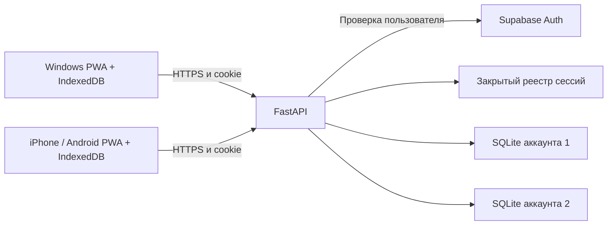

# Academy AI V4 — аккаунты и синхронизация

Работа выполнена 5 ноября 2026 года в ветке `feature/academy-ai-v2`, начиная с V3.1 `09e363d`.

## Состояние реализации

Локально реализованы и проверены авторизация через адаптер Supabase Auth, серверные сессии, разделение аккаунтов, получение прогресса вторым клиентом и защита изменений плана от конфликтов. Приложение по умолчанию запускается с прежним локальным профилем. Для включения аккаунтов нужны параметры настоящего проекта Supabase и настроенная доставка писем.

| Возможность | Состояние |
| --- | --- |
| Регистрация и вход по email-коду | Интерфейс и сервер реализованы, HTTP-контракт проверен с тестовыми ответами Supabase |
| Восстановление доступа | Повторный вход по коду на прежний email, включая новое устройство |
| Сессии и выход | HttpOnly cookie, серверное хранение, обновление токенов, отзыв текущей сессии |
| Несколько устройств | Проверены два независимых TestClient с отдельными cookie одного аккаунта |
| Разделение пользователей | Отдельная SQLite на аккаунт, общий контроль доступа перед личными API |
| Прогресс, XP и streak | Серверные расчёты, повторная отправка UUID возвращает прежнюю квитанцию |
| Учебный план | Общий серверный план, проверка версии перед каждым изменением в режиме аккаунтов |
| Локальные ответы | IndexedDB разделена по проекту Supabase и аккаунту, очередь и черновики восстанавливаются |
| Профиль и настройки | Доступны через значок «Я», включая синхронизацию, выход и число локальных незавершённых работ |
| Реальная доставка писем и сессии Supabase | Требуют проекта и проверки с настоящими кодами |
| Публичная облачная синхронизация | Требует разрешённого размещения backend, HTTPS и постоянного хранилища |
| PostgreSQL / Supabase Database | Архитектура подготовлена, перенос SQLModel и данных остаётся отдельным этапом |
| PWA после полного перезапуска и запуска с иконки | Проверка остаётся открытой |

## Выбранные решения

Для входа выбран Supabase Email OTP. Провайдер создаёт аккаунт, выдаёт и проверяет одноразовый код. Повторный вход по тому же адресу восстанавливает доступ. В шаблоне письма необходимо показать переменную `{{ .Token }}`. Протокол использует `/auth/v1/otp`, `/verify`, `/user`, `/token` и `/logout`. [Документация Supabase Email OTP](https://supabase.com/docs/guides/auth/auth-email-passwordless).

Backend проверяет пользователя через официальный Auth API `/user` по HTTPS. Для каждого личного запроса он получает подтверждённый UUID и выбирает соответствующую базу. Доступность Auth влияет на онлайн-запросы. При недоступности провайдера сервер отвечает 503, а сохранённые локальные занятия остаются доступны.

Cookie содержит случайный идентификатор сессии из стандартного `secrets.token_urlsafe`. На сервере хранится его SHA-256-отпечаток. Cookie действует до 30 дней, имеет `HttpOnly`, `SameSite=Strict` и `Secure` для HTTPS. HTTP разрешён только для loopback-разработки. Смена аккаунта обновляет документ и блокирует отправку старой вкладки. Сервер дополнительно сверяет `X-Academy-Account` с подтверждённым пользователем.

Изменяющие запросы требуют точного `Origin` и заголовка `X-Academy-Request`. Для входа действуют ограничения по адресу клиента и email на десятиминутное окно — 5 запросов кода и 10 проверок. Ограничения самого Supabase также применяются. За обратным прокси нужно корректно настроить доверенные proxy headers, иначе несколько устройств могут разделять один лимит IP.

Access и refresh tokens находятся в серверной `sessions.sqlite3`. Этот файл содержит секреты сессий и требует закрытых прав доступа, защищённого диска и защищённых резервных копий. Для настоящих аккаунтов `ACADEMY_ACCOUNTS_DIR` задаётся явно абсолютным путём вне OneDrive и web root. Браузер хранит только cookie сессии и подсказку для выбора локального профиля. Собственную схему паролей приложение не вводит.

## Хранение и синхронизация

На этом этапе выбрана физическая изоляция SQLite. В каталоге аккаунтов лежат `sessions.sqlite3` и `<Supabase UUID>.db`. Новая база получает учебный контент через уже существующие миграции, а новый профиль начинает с пустым прогрессом. Прежняя `database.db` продолжает обслуживать локальный режим.

Этот выбор позволяет задействовать существующие уроки, IELTS, словарь, календарь, аналитику и транзакции SQLite. Все личные API проходят через единый выбор базы. SQLModel остаётся в учебных модулях. Одновременная ротация refresh token сериализована транзакцией реестра сессий. Подготовка новой базы выполняется во временном файле с последующим переименованием.



`GET /api/sync/snapshot` читает прогресс, dashboard с XP и streak, текущую неделю и версию плана в одной транзакции. Клиент может получить целый актуальный снимок. Для личного объёма данных выбран полный снимок. Поток изменений с курсором остаётся будущим улучшением.

Попытки проходят существующий `/api/offline/attempts`. Их UUID, версия урока, fingerprint, ответы и клиентское время сохраняются. Подтверждённые баллы вычисляются сервером. При повторе одного UUID возвращается прежняя квитанция. Streak использует серверную дату приёма попытки по существующим правилам.

Версия плана вычисляется по содержимому настроек, недель, заданий и переносов. Интерфейс передаёт версию просмотренных данных через `If-Match`. Проверка и изменение выполняются под `BEGIN IMMEDIATE`. Устаревшая версия даёт 409, отсутствие версии в режиме аккаунтов даёт 428. Пользователь получает сообщение и может загрузить свежую версию. Автоматическое слияние противоречащих переносов пока отсутствует. План редактируется при доступном сервере.

База IndexedDB для уроков и очереди, записи IELTS, локальные IELTS-черновики и настройки напоминаний получили пространство имён аккаунта. Старое локальное хранилище V3.1 доступно в локальном режиме. При холодном офлайн-открытии используется сохранённая подсказка профиля, а отправка блокируется до подтверждения аккаунта сервером. Локальные копии хранятся в профиле браузера, поэтому для работы с личными данными нужен личный профиль ОС и браузера.

## Проверки и ограничения среды

- Backend — **61 тест**, включая 54 существующих и 7 новых.
- Frontend — **42 теста**, включая 37 существующих и 5 новых.
- TypeScript и production build — успешно.
- `pip check` и `git diff --check` — успешно. Рабочая SQLite также повторно сравнена с резервной копией V4 после проверок, все записи совпали.
- HTTP smoke — 40 уроков, 11 ресурсов PWA, восстановление результатов, IELTS и плана после перезапуска API, повтор UUID без дополнительного XP.
- Модель двух устройств проверена независимыми TestClient с собственными cookie. Проверены чужие UUID, доступ без сессии, CSRF, выход, сохранение сессии после пересоздания приложения, параллельное обновление токенов, недоступность провайдера и истечение сессии.
- Проверены изоляция IndexedDB, сохранение прежнего локального хранилища, отсутствие отправки чужой очереди и блокировка интерфейса при смене аккаунта в другой вкладке.
- Импорт проверен на копии с демонстрационной попыткой. Все строки совпали, демонстрационная попытка не увеличила XP, повторный импорт получил отказ.

Тестовые ответы Supabase подставлены через `httpx.MockTransport` только в тестах. Обычный запуск обращается к настроенному HTTPS-провайдеру. Реальные письма, реальные refresh tokens Supabase и физические Windows/телефон в этой сессии не проверены.

Для проверки установленного PWA запрошено открытое окно Chrome с Academy AI. Инструмент управления Windows остановил работу, поскольку не смог надёжно определить текущий URL. Поэтому визуальная проверка нового экрана, полный перезапуск Chrome, установка и открытие с иконки остаются открытыми. Существующие автоматические регрессии холодного старта V3.1 успешно пройдены.

Один полный запуск pytest внутри песочницы завис до вывода тестов. Он остановлен и повторён вне песочницы с диагностикой. Итог относится к завершённому прогону. Предупреждение Starlette об устаревающей поддержке `httpx` в TestClient сохраняется.

## Сохранность существующего профиля

Создана копия `backups/academy-v4-start-20261105T160404Z.db`. Проверены целостность и совпадение всех записей. HTTP smoke также сравнил рабочую базу до и после тестирования. Миграции V4 для рабочей `database.db` не требуются, схема остаётся `0009_offline_sync`.

В `scripts/prepare_db.py` исправлено закрытие SQLite-соединений после проверки и копирования. Это устраняет блокировку переименования подготовленной базы в Windows.

Утилита `scripts.import_account` копирует существующий профиль в ещё не созданную базу выбранного аккаунта, делает резервную копию и сравнивает все строки. Если целевая база существует, операция прекращается. Оригинальные демонстрационные строки сохраняются как исторические записи. Расчёт XP продолжает учитывать учебные прохождения по прежним правилам.

Реальный перенос выполняется после выбора владельца и проверки его UUID в Supabase, с остановленным API и до первого входа этого аккаунта в Academy AI. Старую локальную очередь следует отправить и экспортировать до переключения режима. Слияние двух уже использованных профилей требует отдельной процедуры.

```powershell
# После проверки UUID владельца и остановки API
.\.venv\Scripts\python.exe -X utf8 -m scripts.import_account `
  --source .\database.db `
  --accounts-dir "$env:LOCALAPPDATA\AcademyAI\accounts" `
  --user-id 'ПОДТВЕРЖДЁННЫЙ-UUID-ИЗ-SUPABASE'
```

## Запуск локального профиля

Терминал 1 в PowerShell.

```powershell
Set-Location 'C:\Users\user\OneDrive\Рабочий стол\academy ai'
$env:ACADEMY_AUTH_MODE = 'local'
.\.venv\Scripts\python.exe -m uvicorn app.main:app --host 127.0.0.1 --port 8000
```

Терминал 2.

```powershell
Set-Location 'C:\Users\user\OneDrive\Рабочий стол\academy ai\frontend'
npm.cmd run build
npm.cmd run preview
```

Открой `http://127.0.0.1:4173`. Новый профиль доступен по значку «Я». После новой сборки обнови приложение онлайн и примени штатное обновление PWA. Сохрани данные сайта при обновлении.

## Параметры для подключения аккаунтов

Потребуются проект Supabase, выбранный регион, его HTTPS URL и ключ `sb_publishable_…`, адрес приложения, приватный постоянный каталог backend и email владельца. Создание проекта и внешняя публикация требуют отдельного разрешения. Пример `.env.example` служит справочником, автоматическая загрузка `.env` пока отсутствует.

В Supabase включи Email Auth и регистрацию нужных пользователей. Шаблон письма должен содержать `{{ .Token }}`. Встроенная почта рассчитана на тестирование, доставляет письма адресам участников организации и ограничена двумя письмами в час. Для обычных адресов понадобится настроенный SMTP. Его тариф и домен выбираются отдельно. [Ограничения почты Supabase](https://supabase.com/docs/guides/auth/auth-smtp).

После подготовки сервиса и остановки прежнего API можно запустить локальную проверку с настоящим провайдером.

```powershell
Set-Location 'C:\Users\user\OneDrive\Рабочий стол\academy ai'
$env:ACADEMY_AUTH_MODE = 'supabase'
$env:ACADEMY_PUBLIC_ORIGIN = 'http://127.0.0.1:4173'
$env:SUPABASE_URL = 'https://ВАШ-ПРОЕКТ.supabase.co'
$env:SUPABASE_PUBLISHABLE_KEY = 'sb_publishable_ВАШ_КЛЮЧ'
$env:ACADEMY_ACCOUNTS_DIR = "$env:LOCALAPPDATA\AcademyAI\accounts"
.\.venv\Scripts\python.exe -m uvicorn app.main:app --host 127.0.0.1 --port 8000
```

Frontend запускается предыдущей командой preview. Для телефона потребуется доверенный HTTPS и единый origin с проксированием `/api` на FastAPI. Для этого этапа подходит один серверный процесс. Параметры Supabase хранятся в окружении backend. Service-role ключ для этой реализации не нужен.

## Стоимость и варианты размещения

Условия проверены по страницам провайдеров 5 ноября 2026 года. Стоимость указана в USD, окончательная сумма зависит от тарифа, нагрузки и почтового провайдера.

| Вариант | Ориентир | Что потребуется |
| --- | --- | --- |
| Домашний backend и Supabase Auth Free | $0 за облачный тариф в пределах квот, плюс собственный компьютер и почта | Доверенный HTTPS и доступность компьютера |
| Supabase Free | $0, до 50 000 MAU и 500 MB PostgreSQL | Учесть квоты, паузы и резервные копии |
| Render с постоянным диском | От $7 в месяц за compute и $0.25 за GB диска, примерно $7.25 за 1 GB | Одобрение расходов, HTTPS-прокси и постоянный каталог аккаунтов |
| Render Free и Supabase PostgreSQL Free | Потенциально $0 в пределах квот | Сначала перенос хранилища и транзакций на PostgreSQL |

Supabase Free подходит для пилота с ограничениями бесплатного плана. [Тарифы Supabase](https://supabase.com/pricing).

Render Free имеет временную файловую систему, поэтому текущие SQLite-файлы потребуют платного постоянного диска либо другого постоянного хранилища. Платный вариант описан как оценка, он не подключался. [Render Free](https://render.com/docs/free), [Render Pricing](https://render.com/pricing), [Render Disks](https://render.com/docs/disks).

## Переход к реальному размещению

1. Выбрать допустимый бюджет, регион хранения и вариант постоянного backend. Подтвердить создание сервисов и публикацию.
2. Подготовить тестовый проект Supabase и доставку email-кодов. Проверить регистрацию, повторный вход, обновление сессии и выход с реальными письмами.
3. Для размещения текущего пилота выделить закрытый постоянный диск. Настроить один origin HTTPS для PWA и `/api`, права каталога, резервные копии, доверенные proxy headers и ограничения запросов на прокси.
4. Для полностью бесплатной схемы сначала перенести общие учебные таблицы и личные записи в PostgreSQL. Личные таблицы получат `user_id`, уникальности станут учитывать владельца. `BEGIN IMMEDIATE` заменяется подходящими блокировками и транзакциями PostgreSQL. Потребуются RLS и отдельные проверки SQLModel/Alembic на реальном PostgreSQL.
5. Проверить импорт обезличенной копии, два устройства, потерянные ответы сети, конфликт плана, истечение сессии и восстановление backup. Сверить количество строк, связи, XP и streak.
6. Завершить реальную проверку установленного PWA в Windows и на телефоне, включая полное закрытие браузера, авиарежим, черновик, очередь и повторное подключение.
7. После приёмки скопировать профиль выбранному владельцу и выполнить разрешённое размещение. Для отката сохранить исходную базу и проверенную копию. Реестры сессий относятся к секретам backend.

Сейчас общий прогресс получается при обращении к серверу, открытии раздела, повторной проверке сессии и через кнопку синхронизации в профиле. Push-обновления между устройствами, облачная загрузка аудио, офлайн-редактирование плана и автоматическое слияние профилей остаются дальнейшими задачами.

## Git

Серверный этап сохранён коммитом `bceb2cf`, интерфейс и разделение офлайн-данных — `f768d1b`. Документация сохранена следующим отдельным коммитом. Его хеш указан в итоговом сообщении и доступен через `git log -3 --oneline`. Публикация и push в этой работе не выполнялись.
