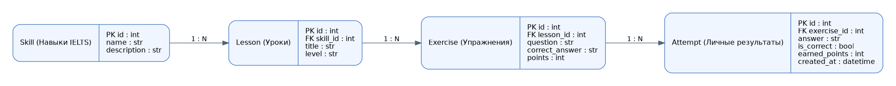

# Academy AI — IELTS Prep

**Дисциплина:** Прикладное программное обеспечение информационных систем (2026)  
**Автор:** Кусымбаев Алан, ИС-24А  
**Лабораторные работы:** №1 и №2

## Описание
Academy AI — учебная информационная система для подготовки к IELTS. Это персональное приложение для одного человека без регистрации: я изучаю английский, тренирую четыре навыка IELTS (Listening, Reading, Writing, Speaking), а программа сохраняет мои попытки и результаты локально. Планируется добавить персональный учебный план, статистику, игровые достижения, напоминания и поддержку компьютера и телефона. Основное обучение не требует платного AI API; локальный ИИ может быть добавлен позже как необязательная функция.

**Важно:** это учебный прототип для лабораторных №1–2: ER-схема, структура файлов, ORM, база и тестовые данные. Пока отсутствуют полноценные IELTS-тесты, оценивание речи/эссе и синхронизация — они не заявляются как реализованные.

## Лабораторная №1: схема и структура



Сущности:
- `Skill` — четыре направления подготовки: Listening, Reading, Writing, Speaking.
- `Lesson` — учебный материал определённого навыка и уровня.
- `Exercise` — конкретный вопрос или задание внутри урока.
- `Attempt` — моя попытка выполнения упражнения: ответ, правильность, баллы и дата.

Связи: `Skill 1:N Lesson`, `Lesson 1:N Exercise`, `Exercise 1:N Attempt`.
Аккаунтов и таблиц `Student`/`User` пока нет: приложение работает локально для одного пользователя. Когда появится необходимость синхронизации между устройствами или поддержки нескольких пользователей, можно добавить `User` и связать с ним `Attempt`.

## Технологии
Python 3.11+, VS Code + AI-ассистент или Cursor, Git/GitHub; FastAPI и Uvicorn для будущего API; SQLModel и SQLite для хранения данных; Streamlit для будущего интерфейса. В ЛР №2 реально используются SQLModel и SQLite.

## Структура
```text
app/
  database/
    db.py          # SQLite engine и init_db()
    models.py      # 4 ORM-модели и Relationship
  frontend/ui.py  # заготовка Streamlit
  routers/exercises.py # заготовка будущих API
  main.py         # заготовка FastAPI
seed.py           # создание таблиц и тестовых данных
verify_db.py      # проверка содержимого
requirements.txt
.gitignore
docs/er_diagram.png
docs/er_diagram.dot # исходник ER-диаграммы (Graphviz)
README.md
```

## Как запустить на Windows (PowerShell)
Откройте корень проекта в VS Code и выполните:
```powershell
python -m venv venv # только если окружение ещё не создано
.\venv\Scripts\python.exe -X utf8 -m pip install -r requirements.txt
.\venv\Scripts\python.exe -X utf8 seed.py
.\venv\Scripts\python.exe -X utf8 verify_db.py
```
`seed.py` создаст `database.db` и добавит **4 навыка, 4 урока, 5 упражнений и 5 личных попыток**. Повторный запуск не дублирует данные. Для чистого запуска можно удалить локальный `database.db` и повторить `seed.py`.

## GitHub (выполнить самостоятельно)
В текущей папке Git ещё не инициализирован. Правила `.gitignore` проверены через `git check-ignore`: `database.db`, `venv/`, `.venv/` и Python-кеш исключены. Push выполняется только с разрешения владельца проекта.

Создайте **публичный** GitHub-репозиторий `applied-is-project-2026` с README и Python `.gitignore` (или пустой репозиторий, если README и .gitignore уже есть в проекте). Скопируйте файлы проекта в локальный каталог репозитория, затем:
```powershell
git add .
git commit -m "feat: academy ai structure and database models"
git push origin main
```
Если локальная папка ещё не является Git-репозиторием, сначала клонируйте репозиторий командой `git clone <ссылка>` и поместите файлы внутрь него. Файл `database.db` и каталог `venv/` не должны попадать на GitHub.

## Что показать преподавателю
1. ER-диаграмму `docs/er_diagram.png` (4 сущности и связи).
2. В VS Code структуру проекта, `requirements.txt` и `.gitignore`.
3. `models.py`: PK, FK, Relationship.
4. Результат `python seed.py` и `python verify_db.py`; файл `database.db` в проводнике.
5. GitHub-репозиторий с загруженными исходниками, README и ER-диаграммой.

## Краткая защита
- `venv` изолирует библиотеки проекта.
- `.gitignore` исключает локальные базы, секреты и виртуальное окружение.
- `git commit` сохраняет версию локально; `git push` отправляет её на GitHub.
- ORM связывает Python-классы с таблицами SQL.
- `exercise_id` в Attempt — реальный внешний ключ, `exercise` — объектная Python-связь Relationship.
- Seeding — добавление тестовых данных; `echo=True` показывает SQL в терминале.

## Проверки лабораторной №2

Проверено 29.10.2026 в существующем `venv` на Python 3.13.15. Версии прямых зависимостей зафиксированы в `requirements.txt`; `pip check` не обнаружил конфликтов.

- Исправлена ошибка `relationship('list[Lesson]')`: убрано отложенное вычисление всех аннотаций; для ещё не объявленных классов используются `list["Lesson"]`, `list["Exercise"]`, `list["Attempt"]`.
- `db.py` включает `PRAGMA foreign_keys=ON` при каждом подключении SQLite. Все три FK обязательны; связи в ER-диаграмме соответствуют моделям. Родитель может иметь 0 или больше дочерних записей, каждая дочерняя запись ссылается ровно на одного родителя.
- `seed.py` успешно добавил 4 навыка, 4 урока, 5 упражнений и 5 попыток; повторный запуск пропускает заполненную базу без дублирования. Заполнение выполняется одной транзакцией; существующие пользовательские данные не удаляются.
- `verify_db.py` проверяет PK, FK, заполненность таблиц, `integrity_check`, `foreign_key_check` и двусторонний обход ORM-связей. При ошибке завершает работу с ненулевым кодом.
- Даты попыток создаются в UTC; SQLite сохраняет их без информации о часовом поясе, поэтому при чтении они трактуются как UTC.

Для сдачи остаётся подготовить GitHub-репозиторий и загрузить исходники с разрешения владельца, затем показать преподавателю ER-диаграмму и успешный запуск двух скриптов. Отдельные требования методички нужно сверить с заданием преподавателя: методичка в проекте отсутствует.
